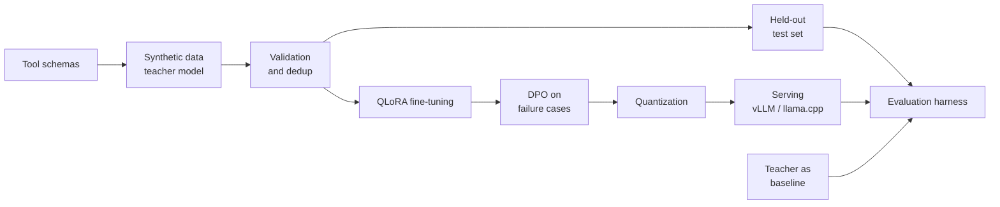

# Distill

**Goal: a small open model that calls an agent's tools as well as a model 30 times its size, and runs on a factory's own hardware.**

> 🚧 Work in progress. Results will be published here as each stage lands.

## Why

AI agents depend on one skill above all: picking the right tool and filling its arguments correctly. Today that usually means sending every request to a very large model. For an industrial plant, that is a problem:

- **Cost and latency:** an operations copilot makes thousands of tool calls a day.
- **Privacy:** production data often cannot leave the site.
- **Reliability:** the plant should keep working when the internet does not.

Distill tests whether a 3 to 4B parameter model, fine-tuned on one domain's tools, can match a large general model on that domain while running locally.

## The use case

A copilot for plant operations teams, with 12 tools:

| Area | Tools |
|---|---|
| Machines | `get_machine_status`, `get_sensor_readings`, `get_failure_risk` |
| Maintenance | `create_maintenance_ticket`, `update_ticket_status`, `schedule_downtime`, `search_maintenance_history` |
| Production | `get_production_kpis`, `get_shift_report` |
| Spare parts | `get_spare_part_stock`, `order_spare_part` |
| People | `notify_team` |

Every tool is a strict Pydantic schema ([`schemas.py`](src/distill/tools/schemas.py)). The same schema validates the training data and grades the model's outputs.

## How it works



1. **Data:** expected tool calls are sampled from the schemas, and an open-weight teacher model (Apache 2.0, so its outputs can be used for training) writes the operator messages that lead to them. Every example is validated, deduplicated and split without leakage. Details below.
2. **Training:** supervised fine-tuning with QLoRA, then DPO on the cases the model still gets wrong.
3. **Serving:** the model is quantized and served through an OpenAI-compatible API, so any agent framework can use it unchanged.
4. **Evaluation:** a held-out test set, scored the same way for the student and the teacher.

## The data

### Labels are correct by construction

The teacher does not invent tool calls. For each example, the pipeline first samples the expected calls inside the schema constraints, then asks the teacher to write a realistic operator message that leads to exactly those calls. This gives full control over the distribution, and labels that never contain a hallucinated argument.

| Category | Share | Expected behavior |
|---|---|---|
| Single call | 62% | One tool call |
| Parallel calls | 14% | Two independent calls from one message |
| Clarification | 12% | A required detail is missing: ask one short question, call nothing |
| Out of scope | 12% | Not about plant operations: decline briefly, call nothing |

Messages are 60% English and 40% French, in nine styles, from polite full sentences to stressed operators during an incident, voice dictation, and bare fragments like "M-104 vibre ticket méca". Each example has its own current date and time, so the model has to resolve relative dates like "tomorrow at 2 pm". Optional arguments are left out half of the time, so the model learns to rely on defaults.

### Every example is checked

| Check | Rejection reason |
|---|---|
| Arguments pass the tool schema | `invalid_call` |
| Every identifier in the label is in the message, exactly or written loosely ("machine 104") | `identifier_missing` |
| Every number, time and date can be read from the message ("2 hours" = 120 minutes) | `number_missing`, `time_missing`, `date_missing` |
| Free-text arguments restate the message and add no new fact | `ungrounded_free_text` |
| Free-text arguments are real values, not the field name | `placeholder_free_text` |
| Enums are written as words, never as code ("in_progress") | `raw_enum_value` |
| A clarification message really lacks the missing identifier | `missing_value_leaked` |
| The message never names a tool | `leaks_tool_name` |
| Clarifications are questions | `bad_reply` |

The grounding checks ([`checks.py`](src/distill/data/checks.py)) came from reviewing the first real run: in 8 examples read by hand, 3 had a label value the operator never said (a ticket note, a search keyword, a result limit). Such labels teach a model to invent arguments, the failure that matters most for an agent. Each of those cases is now a regression test.

Rejected examples are kept in `rejected.jsonl` with the reason, to tune the prompts.

### Robust to messy input

Operators type fast, on phones, sometimes with gloves. On top of the teacher's styles, a noise layer ([`noise.py`](src/distill/data/noise.py)) makes 35% of the training examples messier, without changing their answer:

| Noise | Example |
|---|---|
| Keyboard typos (AZERTY in French, QWERTY in English) | vibration → vibartion |
| Missing accents, lowercase, no punctuation | priorité élevée → priorite elevee |
| SMS abbreviations | s'il te plaît → stp, beaucoup → bcp, please → pls |
| Loose identifiers | M-104 → M104, machine 104; L3 → ligne 3; TCK-00412 → ticket 412 |

Digits are never corrupted, so every value stays recoverable. The test set also gets a fully noisy twin, `test_noisy.jsonl`, to measure how much accuracy the model loses on messy input.

### Embeddings

Multilingual sentence embeddings ([`embeddings.py`](src/distill/embeddings.py), `paraphrase-multilingual-MiniLM-L12-v2`) compare messages by meaning, across French and English:

- **Semantic deduplication:** two messages that mean the same thing *and* expect the same answer are merged. Messages about M-104 and M-105 are both kept: telling them apart is exactly what the model must learn.
- **Semantic leakage check:** a test message that paraphrases a training message with the same answer moves to train.
- **Free-text scoring:** in evaluation, "Vibrations anormales" and "Abnormal vibration" count as the same issue.

### Splits without leakage

Exact and near duplicates are removed (word 3-gram Jaccard similarity). The test set is stratified by category and tool, and any test example too similar to a training example is moved to train, so the test score measures generalization rather than memorization.

**Why the test set is not filtered by the teacher:** a common shortcut is to keep only the examples the teacher solves correctly. That would make the teacher score 100% on the test set by design, and the comparison with the student would be meaningless. Test quality comes from the construction and the checks above, plus a manual review.

### Generating it

Generation runs on Groq's free tier and is resumable: if the daily quota runs out, it stops cleanly and the next run continues where it stopped.

**Automated:** the [`Generate data`](.github/workflows/generate-data.yml) workflow runs this every 6 hours on GitHub Actions, saves progress to the `dataset` branch, and builds the splits once every example is generated. It only needs a `GROQ_API_KEY` repository secret.

**By hand:**

```bash
cp .env.example .env            # then add your GROQ_API_KEY
python -m distill.data.generate --n 3000
python -m distill.data.build --embeddings   # dedup, splits, noise, stats
python -m distill.data.show data/processed/test.jsonl --n 5
```

## Evaluation

Every model takes the same exam ([`src/distill/eval/`](src/distill/eval/)): the copilot system prompt, the operator message and the 12 tool definitions, at temperature 0, through any OpenAI-compatible server (Groq for the teacher, vLLM or llama.cpp for the student).

An answer is correct only if it does exactly what the operator asked:

- **Tool calls:** the right tools, each with every argument right. Arguments are parsed with the tool schema before comparing, so `14:00` equals `14:00:00` and an omitted default equals the default written out. Parallel calls can come in any order. Free-text arguments are compared by meaning, so "Vibrations anormales" matches "abnormal vibration" with `--embeddings`.
- **Clarification:** no tool called, and a question asked. Guessing a machine is a failure.
- **Out of scope:** no tool called, and a reply given.

Each wrong answer gets one outcome (`wrong_arguments`, `wrong_tool`, `missing_call`, `extra_call`, `invalid_call`, `did_not_call`, `called_instead_of_asking`, `called_out_of_scope`...), and argument accuracy is also reported per field (`schedule_downtime.start_time`...), to see exactly where a model fails.

| Metric | Meaning |
|---|---|
| Overall accuracy | Fully correct answers, all categories |
| Valid call rate | Calls that parse and pass the schema |
| Tool accuracy | Right tools chosen, or rightly none |
| Argument accuracy | Every argument right, when the tools are right |
| Clarification accuracy | Asks instead of guessing |
| Out-of-scope accuracy | Declines without calling a tool |
| Robustness | The same metrics on the noisy test set |
| Latency p50 / p95 | Time to a complete answer |

```bash
python -m distill.eval.run --name teacher --model openai/gpt-oss-120b --limit 200
python -m distill.eval.run --name teacher --model openai/gpt-oss-120b --limit 200 \
    --test data/processed/test_noisy.jsonl
python -m distill.eval.compare results/teacher results/qwen3-4b-base results/qwen3-4b-sft
```

`--limit` takes a subset stratified by category and tool, the same one for the clean and noisy files, so the two scores compare example by example. Runs are resumable, like generation.

**A caveat on the teacher's score:** the teacher wrote the test messages, so the exam uses its own phrasing. Its score is an optimistic reference rather than a neutral one, which makes it a harder bar for the student, not an easier one.

Results table: *coming with the teacher baseline and stage 4.*

## Fine-tuning

[`notebooks/kaggle_train.ipynb`](notebooks/kaggle_train.ipynb) runs the whole stage on a free Kaggle T4: exam before training, QLoRA fine-tuning, exam after training, comparison table, adapter upload.

| Choice | Value | Why |
|---|---|---|
| Base model | Qwen3-4B-Instruct-2507 | Apache 2.0, text-only, no thinking mode, tool calling built into its chat template |
| Method | QLoRA with Unsloth: 4-bit base, LoRA rank 16 on every attention and MLP projection | About 1% of the weights trained, fits in 16 GB |
| Loss | Answer tokens only | The model learns to answer, not to repeat the prompt |
| Format | The model's own chat template, with the 12 tools in every prompt | Training and inference see exactly the same text |
| Schedule | 2 epochs, learning rate 2e-4, cosine, effective batch 16 | |

Before spending GPU time, the notebook prints one rendered example and the exact tokens the loss is computed on. A unit test checks the round trip: what the model learns to write is parsed back by the exam as the expected call ([`test_train_format.py`](tests/test_train_format.py)).

Qwen3.5-4B is newer, but it is a vision-language model: its image encoder would add memory and complexity for nothing here.

## Roadmap

- [x] Stage 1: tool schemas, validation, CI
- [x] Stage 2: data pipeline: sampling, generation, validation, deduplication, splits
- [ ] Stage 2b: generate the full dataset and publish it on the Hugging Face Hub
- [x] Stage 3: evaluation harness
- [ ] Stage 3b: teacher baseline
- [x] Stage 4: QLoRA fine-tuning notebook
- [ ] Stage 4b: run it on Kaggle and publish the results
- [ ] Stage 5: DPO on failure cases
- [ ] Stage 6: quantization, serving and benchmarks
- [ ] Stage 7: public demo and evaluation gate in CI

## Quickstart

```bash
git clone https://github.com/benothmen12/distill.git
cd distill
python -m venv .venv && source .venv/bin/activate
make install                     # add the embeddings extra: pip install -e ".[dev,embeddings]"
make test
make tools   # print the tool definitions sent to the model
```

## Project structure

```
distill/
├── src/distill/
│   ├── tools/          # tool schemas, OpenAI export, call validation
│   ├── data/           # scenario sampling, teacher client, grounding checks, noise, splits
│   ├── eval/           # run a model with the tools, score every answer, compare models
│   ├── train/          # training format and QLoRA fine-tuning
│   ├── embeddings.py   # multilingual embeddings: semantic dedup, leakage, similarity
│   └── prompts.py      # the copilot system prompt, shared by training and evaluation
├── notebooks/          # Kaggle notebook for fine-tuning and evaluation on a free GPU
├── tests/              # runs offline with a fake teacher
└── .github/workflows/  # CI on every push, scheduled data generation
```

## License

MIT
